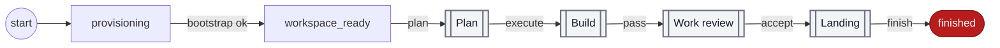
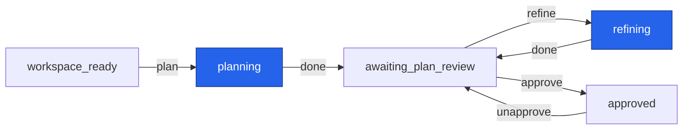
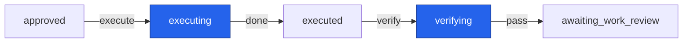
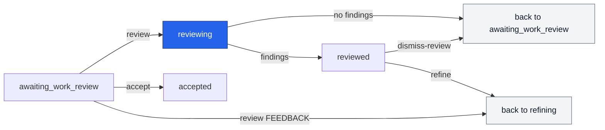
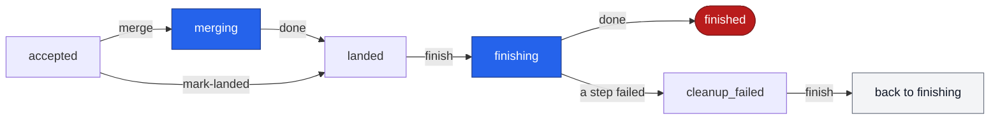
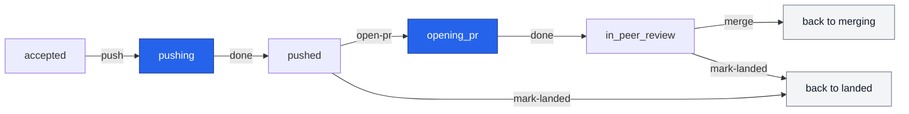
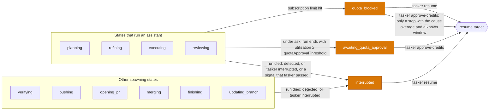
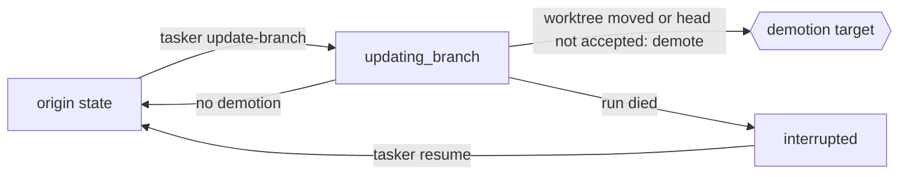

# Task state machine

Each task is in one state. An edge is a permitted change from one state to another.

## States

| State                     | Meaning                                                               |
| ------------------------- | --------------------------------------------------------------------- |
| `provisioning`            | tasker clones the repo, makes the worktree and runs bootstrap.        |
| `workspace_ready`         | The worktree exists. The task waits for `plan`.                       |
| `planning`                | An assistant writes the plan.                                         |
| `awaiting_plan_review`    | The plan waits for you to read it.                                    |
| `refining`                | An assistant revises the plan with feedback.                          |
| `approved`                | You approved the plan. The task waits for `execute`.                  |
| `executing`               | An assistant does the work in the worktree.                           |
| `executed`                | The work is done. The task waits for `verify`.                        |
| `verifying`               | tasker runs the verify commands.                                      |
| `awaiting_work_review`    | The work passed verification and waits for you.                       |
| `reviewing`               | An assistant reviews the work.                                        |
| `reviewed`                | The review found findings. They wait for you.                         |
| `accepted`                | You accepted the work. The task waits to land.                        |
| `pushing`                 | tasker pushes the task branch to `origin`.                            |
| `pushed`                  | The task branch is on `origin`.                                       |
| `opening_pr`              | tasker opens a pull request.                                          |
| `in_peer_review`          | The pull request is open for review.                                  |
| `merging`                 | tasker merges the work into the base branch.                          |
| `landed`                  | The work is on the base branch.                                       |
| `finishing`               | tasker removes the worktree and the task branch.                      |
| `cleanup_failed`          | `finish` stopped before the cleanup ended.                            |
| `finished`                | Terminal. The task is done.                                           |
| `updating_branch`         | tasker moves the worktree onto a newer base.                          |
| `quota_blocked`           | A subscription limit stopped a run.                                   |
| `awaiting_quota_approval` | The quota use passed the threshold. The task waits for your approval. |
| `interrupted`             | The process of a run died, or tasker passed it a signal.              |
| `failed`                  | An operation failed.                                                  |
| `cancelled`               | Terminal. You aborted the task.                                       |

## Rules

- `finished` and `cancelled` are terminal. No edge leaves them.
- A self-transition (an edge from a state to the same state) is never legal.
- Each non-terminal state has an edge to `failed` and an edge to `cancelled`. `failed` has no edge to itself, because
  the self-transition rule wins.

## Main lifecycle

The overview. Each box with a double border is a section below.

`tasker start` creates the task in `provisioning`, then clones, makes the worktree and runs bootstrap. Success moves it
to `workspace_ready`.

Two loops go back to Plan, and the overview does not draw them: `refine` from Work review, and `reopen` from Landing.
Each one writes a new plan revision, which goes through `approve`, Build and Work review again.

In every diagram, an edge label names the command that will take this edge. "done" means that the spawned run finished.
Blue states spawn a process: an assistant, the verify commands, git or the CLI of the forge (`pushing`, `opening_pr`,
`merging`, `finishing`, `updating_branch`). These are the "spawning states".
[A run marker](dev/data-root.md#run_markers-table) covers them, so tasker can find a crash in them. Grey "back to" boxes
show a state a second time, so that a loop does not stretch the layout.

Two things that the diagrams do not show:

- `failed` and `cancelled` can be reached from every non-terminal state. `tasker abort` goes to `cancelled`, and an
  operation that fails goes to `failed`. See "Failure and retry".
- `tasker update-branch` can run from 11 states. See "Update branch".

There is no `awaiting_input` state, because `tasker start` asks about an ambiguous base branch while it runs.

## Plan

## Build

## Work review

`refine` from `reviewed` promotes the findings. `review FEEDBACK` sends your own feedback. Both go to `refining` in
Plan. `dismiss-review` can decline only some findings, with `--finding`. The task goes back to `awaiting_work_review`
only when no finding is left unhandled.

## Landing

`accept` goes to `accepted`. The command you run picks how the task lands: `merge` for the trunk path, or `push` and
`open-pr` for the pull request path. `mark-landed` is for work that landed outside tasker.

### Trunk path

- `merge` from `accepted` fast-forwards the base branch on `origin` to the task sha, with one push. If the push is not a
  fast-forward, the task fails from `merging`. `merge` and `mark-landed` refuse a stacked task until each parent in its
  chain landed and the task moved (see [the stacked-task guards](dev/workspaces.md#stacked-task)). `merge` also refuses
  a base that is a local branch of the tasker clone.
- tasker does not wait for CI. The CI wait is a step of the landing process of each project, outside the state machine.
  There is no `waiting_for_ci` or `ci_failed` state.
- `finish` runs under `finishing`. It removes the worktree and the local branch ref. It deletes the task branch on
  `origin` if tasker published one. It marks the issue done when `updateOnFinish` is set. If someone moved the branch on
  `origin`, `finish` does not delete it. It stops in `cleanup_failed` and skips the tracker write. You decide what to do
  with the extra commits, then run `finish` again. A crash in `finishing` goes to `interrupted`, and `resume` runs the
  cleanup again.

### Pull request path

- `push` publishes the task branch only. It never pushes the base branch.
- `open-pr` does not push. It needs `forge`. It adopts a PR that is already open from the task branch, so a resume never
  opens a second one.
- `merge` from `in_peer_review` merges the PR through the forge with `forge.mergeMethod`, only at the sha that `push`
  published. It lands the task only when the forge then says that the PR is merged. It does not wait for CI.
- After `landed`, the path is the same as the trunk path. `finish` refuses a task in `in_peer_review`.
- `reopen`, from `accepted` or `pushed`, sends a bug found after accept back to `refining` in Plan. It resyncs the
  worktree onto the base tip first.
- To update an open PR, run `update-branch` from `in_peer_review`. It demotes the task to `executed`. Then run `verify`,
  `accept` and `push`. `open-pr` adopts the open PR and returns the task to `in_peer_review`.

## Pauses

- `run died: detected` means that a command found a dead run and moved the task to `interrupted`.
  [The `run_markers` table](dev/data-root.md#run_markers-table) says which commands find a dead run.
- Here is what each part of the label of the edge from the states that run an assistant means. `run died: detected` has
  the meaning of the bullet before this one. `tasker interrupted` names the command `tasker interrupted`. A later
  milestone adds this command, and it marks a dead run that the dead-run step cannot see. `a signal that tasker passed`
  means that tasker passed SIGINT or SIGTERM to the assistant run, and the run ended as an interruption (see
  [The result of an assistant run](dev/tasks.md#the-result-of-an-assistant-run)).
- `verifying`, `pushing`, `opening_pr`, `merging`, `finishing` and `updating_branch` spawn no assistant. Of the pauses,
  the state machine allows only `interrupted` from these states.
- `overagePolicy` picks the quota pause. Under `decline` (the default), a run stops at the overage boundary into
  `quota_blocked`, and `approve-credits` can continue it there when the stop named a window. Under `ask`, a run whose
  use of the quota window reaches `quotaApprovalThreshold` pauses into `awaiting_quota_approval` when the run ends,
  unless the user approved that window with `approve-credits`.
- A resume moves the task to the state before the spawn, then runs the same command again, except for `updating_branch`,
  which runs nothing. So the task goes straight back into a spawning state, except after `updating_branch`.

| Paused from                                 | Resumes to                             | Then runs                                                            |
| ------------------------------------------- | -------------------------------------- | -------------------------------------------------------------------- |
| `planning`                                  | `workspace_ready`                      | `plan` (continues the session)                                       |
| `refining` (plain refine, or from `failed`) | `awaiting_plan_review`                 | `refine`, with the recorded feedback                                 |
| `refining` (from `tasker reopen`)           | `accepted`                             | `reopen`                                                             |
| `refining` (promoted from `reviewed`)       | `reviewed`                             | `refine`, with the recorded feedback or none                         |
| `refining` (from `tasker review FEEDBACK`)  | `awaiting_work_review`                 | `review`, with the recorded feedback                                 |
| `executing`                                 | `approved`                             | `execute` (continues the session)                                    |
| `verifying` (interrupted only)              | `executed`                             | `verify`                                                             |
| `reviewing`                                 | `awaiting_work_review`                 | `review` (in a new session)                                          |
| `pushing` (interrupted only)                | `accepted`                             | `push`. No second push if `origin` already has the sha.              |
| `opening_pr` (interrupted only)             | `pushed`                               | `open-pr`. It adopts an open PR and does not open a second one.      |
| `merging` (interrupted only)                | the recorded merge origin (`accepted`) | `merge`. No second push or merge if the work is already on the base. |
| `finishing` (interrupted only)              | `landed`                               | `finish`. Each cleanup step skips what is already done.              |
| `updating_branch` (interrupted only)        | its origin state                       | nothing. Run `update-branch` again.                                  |

## Failure and retry

`tasker retry` picks the target from the state that the task failed in, then runs the command again. See [Code](#code).

| Failed in                                                   | Retries to                                                                                                                | Then runs                                                                                                               |
| ----------------------------------------------------------- | ------------------------------------------------------------------------------------------------------------------------- | ----------------------------------------------------------------------------------------------------------------------- |
| `provisioning`                                              | `provisioning`. Retry does not move the task. `start` moves it from `failed`.                                             | `start`                                                                                                                 |
| `planning`                                                  | `workspace_ready`                                                                                                         | `plan` (new session)                                                                                                    |
| `refining` (refine from `awaiting_plan_review` or `failed`) | `awaiting_plan_review`                                                                                                    | nothing runs. Retry prints a hint, and you give the next feedback to `refine`.                                          |
| `refining` (from `tasker reopen`)                           | `accepted`                                                                                                                | `reopen`                                                                                                                |
| `refining` (promoted from `reviewed`)                       | `reviewed`                                                                                                                | nothing runs. Retry prints a hint: refine again to act on the findings, or dismiss-review.                              |
| `refining` (from `tasker review FEEDBACK`)                  | `awaiting_work_review`                                                                                                    | nothing runs. Retry prints a hint, and you give the next feedback to `review`.                                          |
| `approved`                                                  | `approved`                                                                                                                | `execute`                                                                                                               |
| `executing`                                                 | `approved`                                                                                                                | `execute` (new session). A done todo gets no turn.                                                                      |
| `verifying`                                                 | `executed`                                                                                                                | `verify`. With `--resume-execute`: `approved`, every todo done, then `execute` continues the session with one fix turn. |
| `reviewing`                                                 | `awaiting_work_review`                                                                                                    | `review` (new session). Retry deletes the review session of the next review number.                                     |
| `accepted` (a failed `tasker push`)                         | `accepted`                                                                                                                | `push`                                                                                                                  |
| `pushing` (the push ended before tasker recorded it)        | `accepted`                                                                                                                | `push`. No second push if `origin` already has the sha.                                                                 |
| `opening_pr`                                                | `pushed`                                                                                                                  | `open-pr`. It adopts an open PR and does not open a second one.                                                         |
| `merging`                                                   | the recorded merge origin (`accepted`)                                                                                    | `merge`. It lands with no second push or merge if the work is already on the base.                                      |
| `quota_blocked`, `awaiting_quota_approval` or `interrupted` | after `planning`, `executing`, `verifying` or `reviewing`: the target of that row. After each other state, retry refuses. | the command of that row. Nothing runs after a refusal.                                                                  |

- If git refuses a merge because the base moved, the task also fails from `merging`. Do not retry it. Run
  `update-branch`, which demotes the task to `executed` (see "Update branch").
- A stopped `finish` does not go to `failed`. It rests in `cleanup_failed`, and `finish` runs again from there.
- `tasker refine FEEDBACK` from `failed` gives the assistant an instruction for a failed task. That sends the task
  through the plan-revision loop. `retry` never takes this edge.
- `tasker abort` has no failure state. If teardown fails, the task stays where it was. Run `abort` again, with `--force`
  if the worktree is dirty.

## Update branch

`tasker update-branch` enters `updating_branch` before any git work, then always leaves it.

- The 11 origin states: `workspace_ready`, `awaiting_plan_review`, `approved`, `executed`, `awaiting_work_review`,
  `reviewed`, `accepted`, `pushed`, `in_peer_review`, `failed`, `cleanup_failed`.
- A task stacked on a parent moves onto the tip of the branch of the parent while the parent is in flight. After the
  parent landed, it moves onto the base that the walk ends on. The task is no longer stacked, or it stays stacked on the
  parent of the end task.

  If the parent changed and the strategy is `rebase`, a task with a synced base tip replays only the commits after that
  tip. This holds while the parent is in flight and after it landed. The commands of the moved-base guard refuse the
  task until `update-branch` moves it (see [the stacked-task guards](dev/workspaces.md#stacked-task)). If the merge base
  is newer than the synced base tip, the replay starts after the merge base.

- If the worktree moved, the old plan approval or verify result no longer describes the tree. So the task is demoted:

| Origin                                                                     | Demoted to             | Why                                                                                                                |
| -------------------------------------------------------------------------- | ---------------------- | ------------------------------------------------------------------------------------------------------------------ |
| `approved`                                                                 | `awaiting_plan_review` | The approval is cleared. The plan was written against the old tree.                                                |
| `awaiting_work_review`, `reviewed`, `accepted`, `pushed`, `in_peer_review` | `executed`             | Landing goes back behind a real `verify` run.                                                                      |
| `failed`, from a failed `push`, `merge`, `open-pr` or `review`             | `executed`             | The same reason. Without the demotion, a retry can push, merge, open a PR or review the moved tree with no verify. |
| any other                                                                  | its origin             | Nothing to demote.                                                                                                 |

- A task in `accepted`, or a task that failed from `merging`, whose head is not the accepted revision goes to
  `executed`, also when the command moved nothing. A task with no accepted revision counts the same way. A commit after
  `tasker accept` has no review, and `tasker merge` refuses its tip.
- A failure after the move to `updating_branch` restores the worktree. If the head is the head of the start, the
  worktree is on the task branch and the worktree is clean, the task goes back to its origin state. Otherwise the task
  goes to `failed`.
- `tasker approve` refuses a plan that is older than the last move of the worktree. The plan was written against the old
  tree, so the user runs `tasker refine` first.

## The commands of each state

`tasker show`, `tasker status` and the wrong-state error name the commands that are valid from the state of a task. They
read one table. The table lives in `src/state/commands.ts`.

| State                                                                                                                                                                    | Primary command   | Commands, in order                                   |
| ------------------------------------------------------------------------------------------------------------------------------------------------------------------------ | ----------------- | ---------------------------------------------------- |
| `provisioning`                                                                                                                                                           | `start`           | `start`, `abort`                                     |
| `workspace_ready`                                                                                                                                                        | `plan`            | `plan`, `update-branch`, `abort`                     |
| `awaiting_plan_review`                                                                                                                                                   | none              | `refine`, `approve`, `update-branch`, `abort`        |
| `approved`                                                                                                                                                               | `execute`         | `execute`, `unapprove`, `update-branch`, `abort`     |
| `executed`                                                                                                                                                               | `verify`          | `verify`, `update-branch`, `abort`                   |
| `awaiting_work_review`                                                                                                                                                   | none              | `review`, `accept`, `update-branch`, `abort`         |
| `reviewed`                                                                                                                                                               | none              | `refine`, `dismiss-review`, `update-branch`, `abort` |
| `accepted`                                                                                                                                                               | `merge`           | `merge`, `mark-landed`, `update-branch`, `abort`     |
| `pushed`                                                                                                                                                                 | none              | `mark-landed`, `update-branch`, `abort`              |
| `in_peer_review`                                                                                                                                                         | none              | `mark-landed`, `update-branch`, `abort`              |
| `landed`                                                                                                                                                                 | `finish`          | `finish`, `abort`                                    |
| `cleanup_failed`                                                                                                                                                         | `finish`          | `finish`, `update-branch`, `abort`                   |
| `failed`                                                                                                                                                                 | `retry`           | `retry`, `refine`, `update-branch`, `abort`          |
| `quota_blocked`                                                                                                                                                          | `resume`          | `resume`, `approve-credits`, `abort`                 |
| `awaiting_quota_approval`                                                                                                                                                | `approve-credits` | `approve-credits`, `abort`                           |
| `interrupted`                                                                                                                                                            | `resume`          | `resume`, `abort`                                    |
| each other state that is not terminal: `planning`, `refining`, `executing`, `verifying`, `reviewing`, `pushing`, `opening_pr`, `merging`, `finishing`, `updating_branch` | none              | `abort`                                              |
| `finished`, `cancelled`                                                                                                                                                  | no row            | no row                                               |

The rules of the table:

- The primary command is the clear next step. A state with two or more choices for the user has no primary command.
- `abort` is the last command of each row.
- A terminal state has no row.
- The table is the one home of the states that each command accepts. A command accepts a state when the row of that
  state names the command. The wrong-state error lists these states in the order of the states in
  `src/state/machine.ts`.
- A command can have a rule that the table cannot hold. That rule stays next to the table check of the command. For
  example, `start` also continues a task in `failed` that failed in `provisioning`. The rule lives in
  `src/tasks/start.ts`.
- A later ticket that adds a command or an edge adds its row.

## Code

[data-root.md](dev/data-root.md#writes-from-more-than-one-process) gives the transaction rule of a move and of an
illegal edge.

The event of a failure records the state that the task failed in. `tasker retry` reads that state to pick its target.
For the origin `refining`, it also reads the `from` of the last move into `refining`. For the origin `merging`, retry
and resume also read the `from` of the last move into `merging`. For the origins `quota_blocked`,
`awaiting_quota_approval` and `interrupted`, retry also reads the `from` of the last move into the pause, and only
`planning`, `executing`, `verifying` and `reviewing` give a row.
