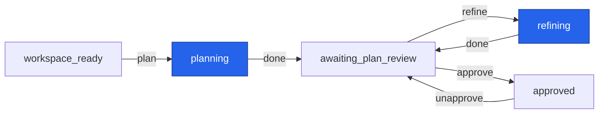
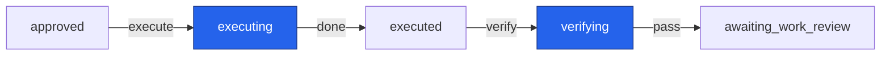
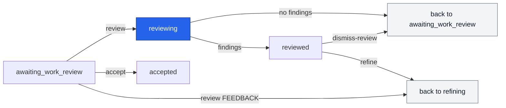
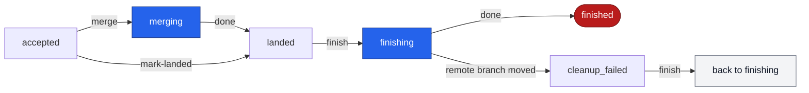
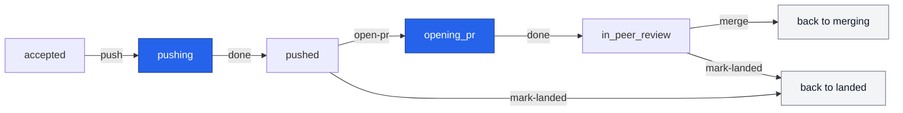
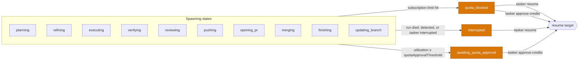
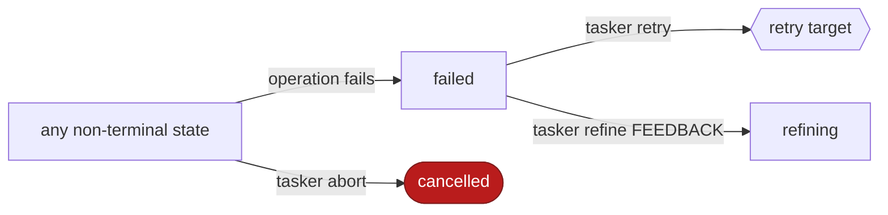
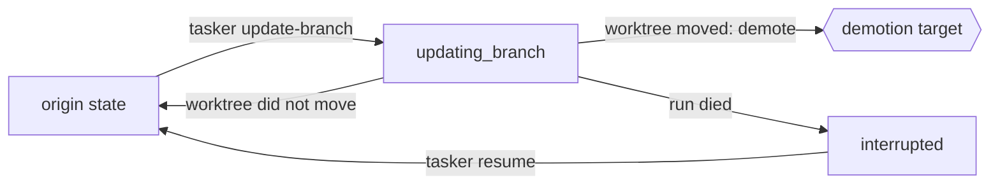

# Task state machine

Each task is in one state. An edge is a permitted change from one state to another.

The module declares 28 states. It does not declare `awaiting_input`.

The code is in `src/state/machine.ts`. No command uses the module yet. Later commands will use it to check their starting state.

## States

| State | Meaning |
| --- | --- |
| `provisioning` | tasker clones the repo, makes the worktree and runs bootstrap. |
| `workspace_ready` | The worktree exists. The task waits for `plan`. |
| `planning` | An assistant writes the plan. |
| `awaiting_plan_review` | The plan waits for you to read it. |
| `refining` | An assistant revises the plan with feedback. |
| `approved` | You approved the plan. The task waits for `execute`. |
| `executing` | An assistant does the work in the worktree. |
| `executed` | The work is done. The task waits for `verify`. |
| `verifying` | tasker runs the verify commands. |
| `awaiting_work_review` | The work passed verification and waits for you. |
| `reviewing` | An assistant reviews the work. |
| `reviewed` | The review found findings. They wait for you. |
| `accepted` | You accepted the work. The task waits to land. |
| `pushing` | tasker pushes the task branch to `origin`. |
| `pushed` | The task branch is on `origin`. |
| `opening_pr` | tasker opens a pull request. |
| `in_peer_review` | The pull request is open for review. |
| `merging` | tasker merges the work into the base branch. |
| `landed` | The work is on the base branch. |
| `finishing` | tasker removes the worktree and the task branch. |
| `cleanup_failed` | `finish` stopped before the cleanup ended. |
| `finished` | Terminal. The task is done. |
| `updating_branch` | tasker moves the worktree onto a newer base. |
| `quota_blocked` | A subscription limit stopped a run. |
| `awaiting_quota_approval` | The quota use passed the threshold. The task waits for your approval. |
| `interrupted` | The process of a run died. |
| `failed` | An operation failed. |
| `cancelled` | Terminal. You aborted the task. |

## Rules

- `finished` and `cancelled` are terminal. No edge leaves them.
- A self-transition (an edge from a state to the same state) is never legal.
- Each non-terminal state has an edge to `failed` and an edge to `cancelled`. `failed` has no edge to itself, because the self-transition rule wins.

## Main lifecycle

The overview. Each box with a double border is a section below.

`tasker start` creates the task in `provisioning`, then clones, makes the worktree and runs bootstrap. Success moves it to `workspace_ready`.

Two loops go back to Plan, and the overview does not draw them: `refine` from Work review, and `reopen` from Landing. Each one writes a new plan revision, which goes through `approve`, Build and Work review again.

In every diagram, an edge label names the command that will take this edge. "done" means that the spawned run finished. Blue states spawn a process: an assistant, the verify commands, git or the CLI of the forge (`pushing`, `opening_pr`, `merging`, `finishing`, `updating_branch`). These are the "spawning states". A run marker covers them, so tasker can find a crash in them. Grey "back to" boxes show a state a second time, so that a loop does not stretch the layout.

Two things that the diagrams do not show:

- `failed` and `cancelled` can be reached from every non-terminal state. `tasker abort` goes to `cancelled`, and an operation that fails goes to `failed`. See "Failure and retry".
- `tasker update-branch` can run from 11 states. See "Update branch".

The module does not declare `awaiting_input`. `tasker start` asks about an ambiguous base branch while it runs.

## Plan

## Build

## Work review

`refine` from `reviewed` promotes the findings. `review FEEDBACK` sends your own feedback. Both go to `refining` in Plan. `dismiss-review` can decline only some findings, with `--finding`. The task goes back to `awaiting_work_review` only when no finding is left unhandled.

## Landing

`accept` goes to `accepted`. The command you run picks how the task lands: `merge` for the trunk path, or `push` and `open-pr` for the pull request path. `mark-landed` is for work that landed outside tasker.

### Trunk path

- `merge` from `accepted` fast-forwards the base branch on `origin` to the task sha, with one push. If the push is not a fast-forward, the task fails from `merging`. `merge` refuses a stacked task, and a base that is a local branch of the tasker clone.
- tasker does not wait for CI. The CI wait is a step of the landing process of each project, outside the state machine. There is no `waiting_for_ci` or `ci_failed` state.
- `finish` runs under `finishing`. It removes the worktree and the local branch ref. It deletes the task branch on `origin` if tasker published one. It marks the issue done when `updateOnFinish` is set. If someone moved the branch on `origin`, `finish` does not delete it. It stops in `cleanup_failed` and skips the tracker write. You decide what to do with the extra commits, then run `finish` again. A crash in `finishing` goes to `interrupted`, and `resume` runs the cleanup again.

### Pull request path

- `push` publishes the task branch only. It never pushes the base branch.
- `open-pr` does not push. It needs `forge`. It adopts a PR that is already open from the task branch, so a resume never opens a second one.
- `merge` from `in_peer_review` merges the PR through the forge with `forge.mergeMethod`, only at the sha that `push` published. It lands the task only when the forge then says that the PR is merged. It does not wait for CI.
- After `landed`, the path is the same as the trunk path. `finish` refuses a task in `in_peer_review`.
- `reopen`, from `accepted` or `pushed`, sends a bug found after accept back to `refining` in Plan. It resyncs the worktree onto the base tip first.
- To update an open PR, run `update-branch` from `in_peer_review`. It demotes the task to `executed`. Then run `verify`, `accept` and `push`. `open-pr` adopts the open PR and returns the task to `in_peer_review`.

## Pauses

- `verifying`, `pushing`, `opening_pr`, `merging`, `finishing` and `updating_branch` spawn no assistant. As a result, only `interrupted` can come from them in practice. The two quota edges from these states are in the table, but no run can reach them.
- `overagePolicy` picks the quota pause. Under `decline` (the default), a run stops at the overage boundary into `quota_blocked`, and `approve-credits` can continue it there. Under `ask`, the threshold pause into `awaiting_quota_approval` applies.
- A resume moves the task to the state before the spawn, then runs the same command again. So the task goes straight back into a spawning state.

| Paused from | Resumes to | Then runs |
| --- | --- | --- |
| `planning` | `workspace_ready` | `plan` |
| `refining` (plain refine) | `awaiting_plan_review` | `refine` |
| `refining` (from `tasker reopen`) | `accepted` | `reopen` |
| `refining` (promoted from `reviewed`) | `reviewed` | `refine`, with the recorded findings again |
| `refining` (from `tasker review FEEDBACK`) | `awaiting_work_review` | `review FEEDBACK` |
| `executing` | `approved` | `execute` (continues the session) |
| `verifying` (interrupted only) | `approved` | `execute` (continues the session) |
| `reviewing` | `awaiting_work_review` | `review` |
| `pushing` (interrupted only) | `accepted` | `push`. No second push if `origin` already has the sha. |
| `opening_pr` (interrupted only) | `pushed` | `open-pr`. It adopts an open PR and does not open a second one. |
| `merging` (interrupted only) | the recorded merge origin (`accepted` or `in_peer_review`) | `merge`. No second push or merge if the work is already on the base. |
| `finishing` (interrupted only) | `landed` | `finish`. Each cleanup step skips what is already done. |
| `updating_branch` (interrupted only) | its origin state | nothing. Run `update-branch` again. |

## Failure and retry

`tasker retry` picks the target from the state that the task failed in, then runs the command again. `failTask()` records that state (see [Code](#code)).

| Failed in | Retries to | Then runs |
| --- | --- | --- |
| `provisioning` (also a task stuck in `provisioning`) | `provisioning` | `start` |
| `planning` | `workspace_ready` | `plan` (fresh session) |
| `refining` (plain refine) | `awaiting_plan_review` | `refine` |
| `refining` (from `tasker reopen`) | `accepted` | `reopen` |
| `refining` (promoted from `reviewed`) | `reviewed` | nothing. It rests there. |
| `refining` (from `tasker review FEEDBACK`) | `awaiting_work_review` | nothing. It rests there. |
| `approved` | `approved` | `execute` |
| `executing` | `approved` | `execute` (fresh session) |
| `verifying` | `executed` | `verify`. With `--resume-execute`: `approved`, then `execute` continues the session with one fix turn. |
| `reviewing` | `awaiting_work_review` | `review` (fresh session) |
| `accepted` (a failed `tasker push`) | `accepted` | `push` |
| `pushing` (the push ended before tasker recorded it) | `accepted` | `push`. No second push if `origin` already has the sha. |
| `opening_pr` | `pushed` | `open-pr`. It adopts an open PR and does not open a second one. |
| `merging` | the recorded merge origin (`accepted` or `in_peer_review`) | `merge`. It lands with no second push or merge if the work is already on the base. |

- If git refuses a merge because the base moved, the task also fails from `merging`. Do not retry it. Run `update-branch`, which demotes the task to `executed` (see "Update branch").
- A stopped `finish` does not go to `failed`. It rests in `cleanup_failed`, and `finish` runs again from there.
- `tasker refine FEEDBACK` from `failed` gives the assistant an instruction for a failed task. That sends the task through the plan-revision loop. `retry` never takes this edge.
- `tasker abort` has no failure state. If teardown fails, the task stays where it was. Run `abort` again, with `--force` if the worktree is dirty.

## Update branch

`tasker update-branch` enters `updating_branch` before any git work, then always leaves it.

- The 11 origin states: `workspace_ready`, `awaiting_plan_review`, `approved`, `executed`, `awaiting_work_review`, `reviewed`, `accepted`, `pushed`, `in_peer_review`, `failed`, `cleanup_failed`.
- A task stacked on a parent that landed moves onto the base of the parent. If the parent changed when it landed, only the commits of the task are replayed.
- If the worktree moved, the old plan approval or verify result no longer describes the tree. So the task is demoted:

| Origin | Demoted to | Why |
| --- | --- | --- |
| `approved` | `awaiting_plan_review` | The approval is cleared. The plan was written against the old tree. |
| `awaiting_work_review`, `reviewed`, `accepted`, `pushed`, `in_peer_review` | `executed` | Landing goes back behind a real `verify` run. |
| `failed`, from a failed `push`, `merge`, `open-pr` or `review` | `executed` | The same reason. A retry would push, merge, open a PR or review the moved tree with no verify. |
| any other | its origin | Nothing to demote. |

## All edges

| From | To (specific edges) |
| --- | --- |
| `provisioning` | `workspace_ready` |
| `workspace_ready` | `planning`, `updating_branch` |
| `planning` | `awaiting_plan_review`, `quota_blocked`, `awaiting_quota_approval`, `interrupted` |
| `awaiting_plan_review` | `refining`, `approved`, `updating_branch` |
| `refining` | `awaiting_plan_review`, `quota_blocked`, `awaiting_quota_approval`, `interrupted` |
| `approved` | `awaiting_plan_review`, `executing`, `updating_branch` |
| `executing` | `executed`, `quota_blocked`, `awaiting_quota_approval`, `interrupted` |
| `executed` | `verifying`, `updating_branch` |
| `verifying` | `awaiting_work_review`, `quota_blocked`, `awaiting_quota_approval`, `interrupted` |
| `awaiting_work_review` | `reviewing`, `refining`, `accepted`, `updating_branch` |
| `reviewing` | `awaiting_work_review`, `reviewed`, `quota_blocked`, `awaiting_quota_approval`, `interrupted` |
| `reviewed` | `refining`, `awaiting_work_review`, `updating_branch` |
| `accepted` | `landed`, `merging`, `pushing`, `refining`, `updating_branch` |
| `pushing` | `pushed`, `quota_blocked`, `awaiting_quota_approval`, `interrupted` |
| `pushed` | `landed`, `opening_pr`, `refining`, `updating_branch` |
| `opening_pr` | `in_peer_review`, `quota_blocked`, `awaiting_quota_approval`, `interrupted` |
| `in_peer_review` | `landed`, `merging`, `updating_branch` |
| `merging` | `landed`, `quota_blocked`, `awaiting_quota_approval`, `interrupted` |
| `landed` | `finishing` |
| `finishing` | `finished`, `cleanup_failed`, `quota_blocked`, `awaiting_quota_approval`, `interrupted` |
| `cleanup_failed` | `finishing`, `updating_branch` |
| `finished` | none (terminal) |
| `updating_branch` | `workspace_ready`, `awaiting_plan_review`, `approved`, `executed`, `awaiting_work_review`, `reviewed`, `accepted`, `pushed`, `in_peer_review`, `failed`, `cleanup_failed`, `quota_blocked`, `awaiting_quota_approval`, `interrupted` |
| `quota_blocked` | `workspace_ready`, `awaiting_plan_review`, `approved`, `awaiting_work_review`, `accepted`, `reviewed` |
| `awaiting_quota_approval` | `workspace_ready`, `awaiting_plan_review`, `approved`, `awaiting_work_review`, `accepted`, `reviewed` |
| `interrupted` | `workspace_ready`, `awaiting_plan_review`, `approved`, `awaiting_work_review`, `accepted`, `reviewed`, `executed`, `in_peer_review`, `pushed`, `cleanup_failed`, `landed` |
| `failed` | `provisioning`, `workspace_ready`, `awaiting_plan_review`, `approved`, `executed`, `accepted`, `awaiting_work_review`, `reviewed`, `in_peer_review`, `refining`, `pushed`, `updating_branch` |
| `cancelled` | none (terminal) |

Each non-terminal state also has an edge to `failed` (except `failed` itself) and to `cancelled`. As a result, the legal set has 170 edges.

## Code

- `src/state/machine.ts` declares `STATES`, `TERMINAL_STATES` and the edge table.
- `canTransition(from, to)` returns `true` when the edge is legal.
- `transitionTask(store, id, to, detail?)` changes the state of a task. It writes the new state and one `transition` event `{ ...detail, from, to }` in one database transaction, through the `check` argument of `updateTask()` (see `docs/dev/data-root.md`). `detail` cannot set `from` or `to`: the type rejects them, and the values of the machine win at run time. If the edge is illegal, it throws `illegal state transition: <from> -> <to>`, and it writes nothing: no state change and no event.
- `failTask(store, id, message)` moves a task to `failed` through `transitionTask()`. The event holds the error `message`, so it records the state that the task failed in.
- `failedFrom(store, id)` returns the `from` of the last `transition` event into `failed`. It returns `undefined` when the task is not in `failed`, when it has no such event, or when that `from` is not a task state. It reads no older event.
